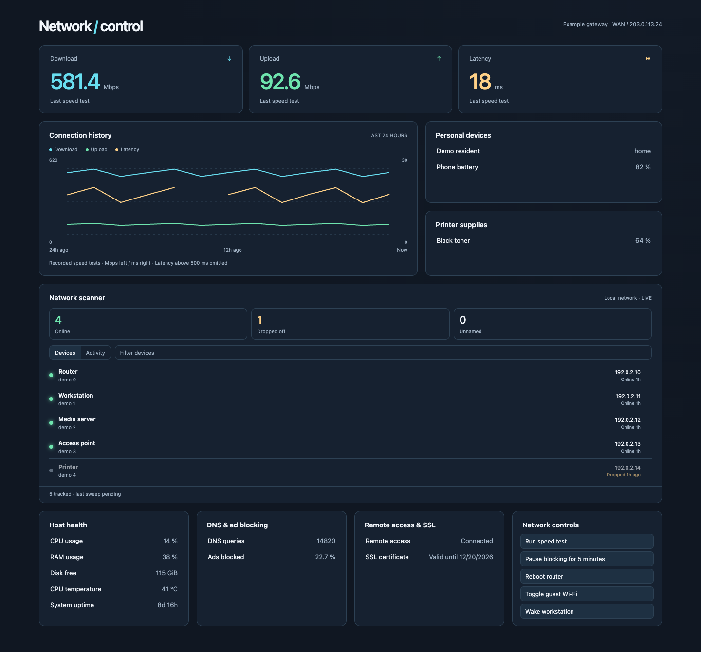

# Network Control for Home Assistant

A responsive Home Assistant network dashboard for internet speed, Wi-Fi device presence, host health, DNS blocking, VPN and certificate status. Includes a live Nmap Tracker device list, 24-hour history, and optional network controls.

[](https://my.home-assistant.io/redirect/hacs_repository/?owner=yanke7&repository=Home-Assistant-Network&category=integration)

## Configuration

Paste [dashboard.yaml](dashboard.yaml) into a new dashboard. Its single card is the configuration point. Uncomment the settings you need and substitute your own entity IDs.

```yaml
type: custom:yanke-network-control
download_sensor: sensor.speedtest_download
upload_sensor: sensor.speedtest_upload
latency_sensor: sensor.speedtest_ping
latency_max_ms: 500
# wan_sensor: sensor.router_external_ip
# router_entity: sensor.router_external_ip
# show_wan_ip: true
# personal_entities: [person.resident, sensor.phone_battery_level]
# printer_entities: [sensor.printer_black_toner_remaining]
# remote_access_entity: binary_sensor.vpn_connected
# ssl_entity: sensor.certificate_expiry
```



## Install

1. Open the install link above, or add `https://github.com/yanke7/Home-Assistant-Network` as a custom repository of type **Integration** in Marketplace or HACS. Download **Network Control**.
2. Restart Home Assistant. In **Settings → Devices & services → Add integration**, choose **Network Control**. It loads the dashboard card automatically.
3. Create a dashboard in **Settings → Dashboards**. Open its raw configuration editor and paste [dashboard.yaml](dashboard.yaml). Refresh the browser after setup. You can also add **Network Control** from the card picker.

For manual installation, copy `custom_components/network_control` to the same path under your Home Assistant configuration directory, then follow steps 2–3.

## Optional integrations and controls

Everything below is optional. Missing entities show “Entity not configured.” The printer panel hides when no supplies are found.

| Feature | Provider and configuration |
| --- | --- |
| Speed and history | [Speedtest.net](https://www.home-assistant.io/integrations/speedtestdotnet/) and [Recorder](https://www.home-assistant.io/integrations/recorder/). Run a test through the native update action or set `speedtest_action_entity` to a button or script. The spinner stays visible until Home Assistant responds. Latency above the configured cap is omitted from the chart. |
| Device presence | [Nmap Tracker](https://www.home-assistant.io/integrations/nmap_tracker/) for your own LAN. Admin users can enable newly discovered trackers and rename devices. [Person](https://www.home-assistant.io/integrations/person/) and Companion App battery/storage sensors populate Personal devices. |
| WAN and printer | A router external IP sensor and [IPP](https://www.home-assistant.io/integrations/ipp/) or equivalent supply sensors. Use the config keys above when entity names differ. WAN IP and MAC display are opt-in. Set `show_mac: true` to display scanner MAC addresses. |
| Host health | [System Monitor](https://www.home-assistant.io/integrations/systemmonitor/) with processor use, memory usage, disk free, processor temperature and uptime sensors enabled. Override discovery with `cpu_sensor`, `memory_sensor`, `disk_sensor`, `temperature_sensor` and `uptime_sensor`. |
| DNS | [Pi-hole](https://www.home-assistant.io/integrations/pi_hole/) or [AdGuard Home](https://www.home-assistant.io/integrations/adguard/). AdGuard reports its configured statistics window. Override discovery with `dns_queries_sensor` and `dns_blocked_sensor`. Set `pihole_switch` to the Pi-hole switch for a native five-minute pause. |
| AdGuard pause | Import the [AdGuard script blueprint](https://my.home-assistant.io/redirect/blueprint_import/?blueprint_url=https%3A%2F%2Fgithub.com%2Fyanke7%2FHome-Assistant-Network%2Fblob%2Fmain%2Fblueprints%2Fpause-adguard.yaml), create a script using the filtering switch, and set `dns_pause_script` to the resulting script entity. A Home Assistant restart interrupts the delay. If interrupted, turn filtering back on in AdGuard. |
| Restart and reboot | Set `enable_restart: true` for the admin-only Home Assistant restart button. Set `host_reboot_entity` to a button or script supported by your installation. |
| Router and guest Wi-Fi | Set `router_reboot_entity` to an exposed reboot button or script. Set `guest_wifi_entity` to a switch from your router integration, such as UniFi, AsusWRT or Omada, depending on hardware support. |
| Wake-on-LAN | Add configured [Wake-on-LAN](https://www.home-assistant.io/integrations/wake_on_lan/) buttons or scripts to `wake_entities`. |
| VPN, remote access and TLS | Set `remote_access_entity` to a status sensor supplied by your VPN or remote access setup. For SSL, use [Certificate Expiry](https://www.home-assistant.io/integrations/cert_expiry/) or set `ssl_entity` to your certificate-expiry timestamp sensor. |

Use an administrator-only dashboard for private network information and controls. Restart, reboot, guest Wi-Fi and DNS pause actions prompt for confirmation. The card calls Home Assistant's existing services using the signed-in user's permissions.

## Theme

The card ships with its own stylesheet and standalone defaults. To use the palette on other dashboards, copy [theme.yaml](theme.yaml) into your `themes` directory, include that directory under `frontend.themes`, reload themes, and select **Network Control**.

## Preview and feedback

The screenshot comes from [a synthetic demo](docs/demo.html). Serve this repository with `python3 -m http.server` and open `/docs/demo.html` to try the card without Home Assistant. Add `?empty` to test missing entities.

Report issues with your Home Assistant version and the optional integrations you use. Replace IPs, MAC addresses, location data, and personal device names before attaching screenshots or logs.
