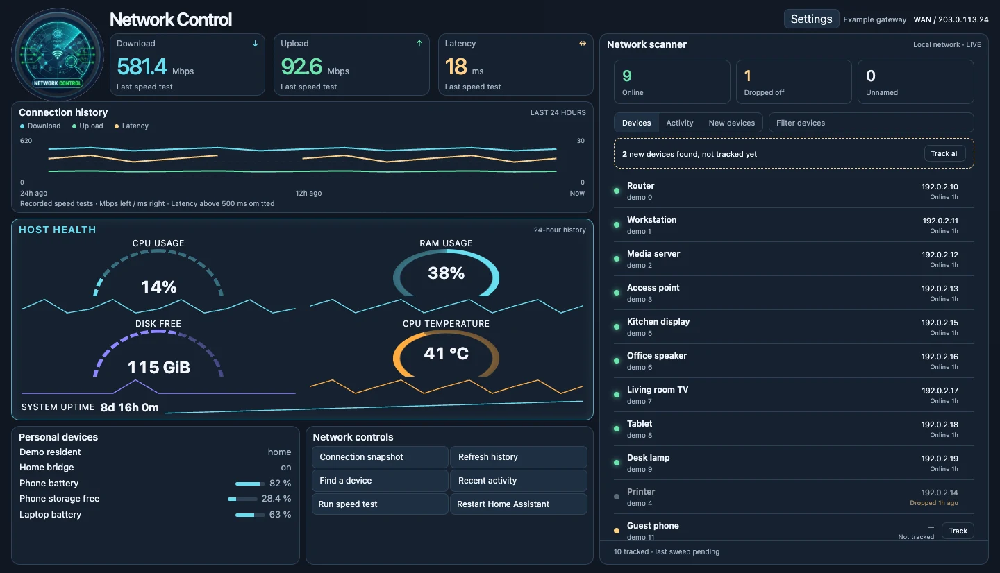
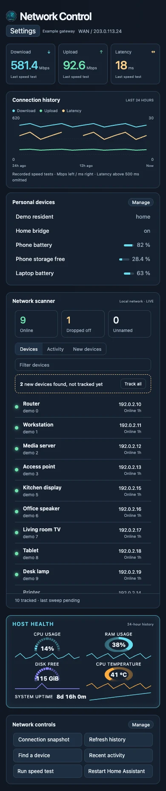
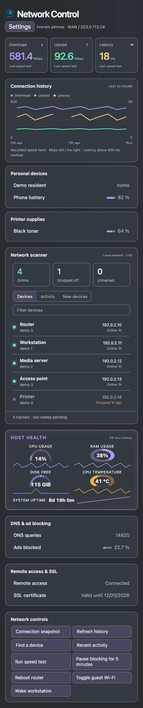
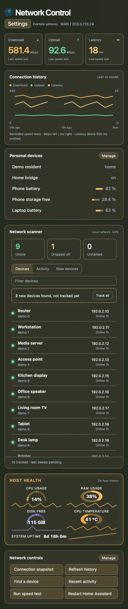
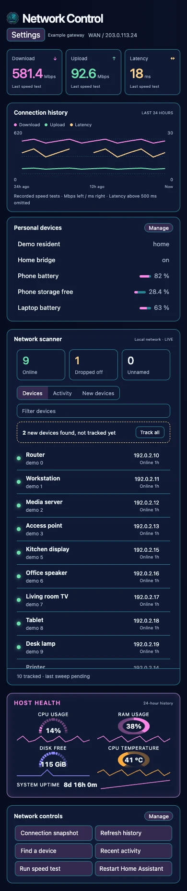
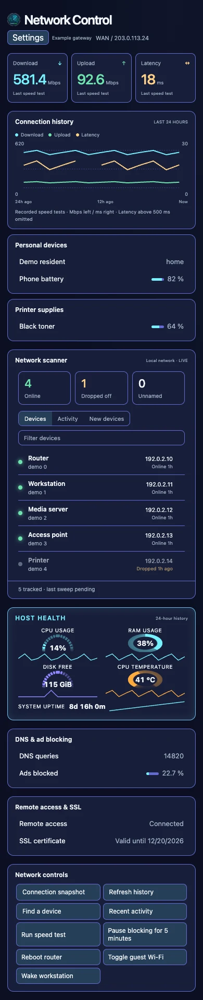
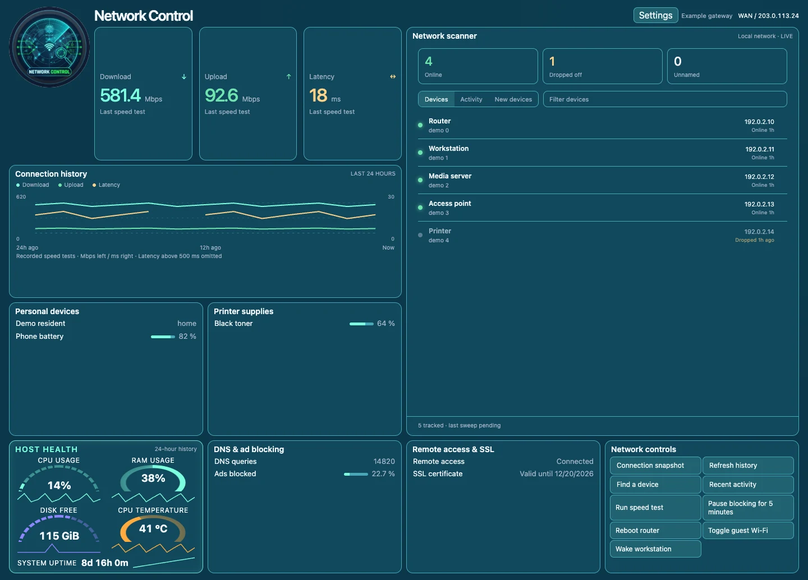
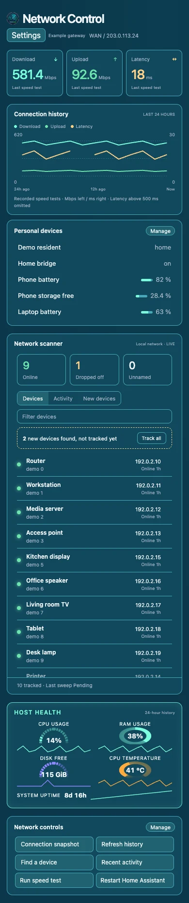
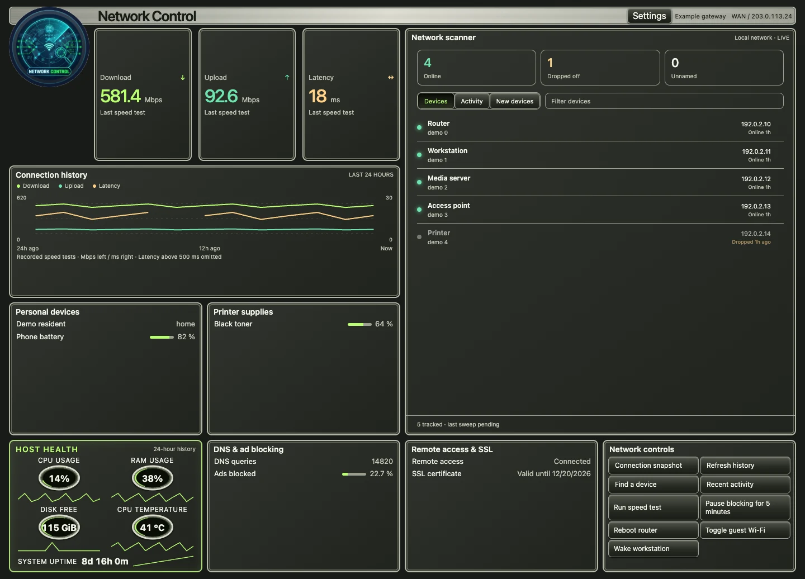
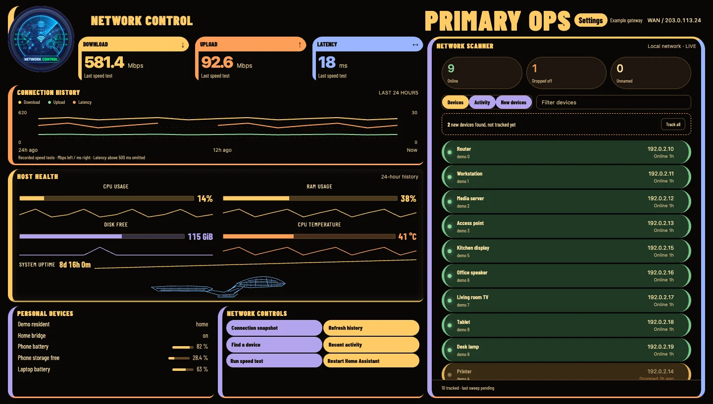

# Network Control for Home Assistant


Network Control is a Home Assistant network monitoring dashboard for checking internet speed, finding devices on your LAN, and keeping an eye on your Home Assistant host. It puts download, upload, ping, device activity, and host health history on one screen.

## Watch the 30-second overview

https://github.com/user-attachments/assets/4cfd890a-ab76-42b4-b8be-fc31e116d012

[Download the MP4](https://github.com/yanke7/Home-Assistant-Network/releases/download/v1.20.2/network-explainer.mp4) or [watch on GitHub](https://github.com/yanke7/Home-Assistant-Network#watch-the-30-second-overview) to see the dashboard, supported integrations, example automations, and language settings.

[](https://my.home-assistant.io/redirect/hacs_repository/?owner=yanke7&repository=Home-Assistant-Network&category=integration)

## Dashboard features

| Section | What you can see and do |
| --- | --- |
| **Internet speed** | See the latest download, upload, and ping. Run the built-in Speedtest on demand, schedule it at an adjustable interval, or connect your existing speed-test entities. The default schedule is hourly. |
| **Connection history** | Compare speed and latency over the last 24 hours using Home Assistant Recorder. Adjust the latency limit to keep unusually high readings from flattening the chart. Use **Refresh history** to reload readings or **Connection snapshot** to get a copyable summary. |
| **Host health** | Monitor CPU usage, RAM, free disk space, CPU temperature where supported, and uptime. Hover over a history graph for the exact reading and time. Built-in sensors collect readings every minute, and the visual editor can use existing sensors for any metric. |
| **Network scanner** | Pair with Nmap Tracker to see online, dropped, unnamed, and newly discovered devices. Search by name, IP, MAC, or vendor. Use the **Activity** tab for recent joins and drops. Admins can name devices and use **Track** or **Track all** to enable discovered trackers. |
| **Personal devices** | Discover Home Assistant people and Companion App battery and storage readings automatically, or choose which entities to display. Select a reading to open its Home Assistant details. |
| **Printer supplies** | Show available ink or toner levels from IPP or compatible sensors. The panel can appear automatically when supply sensors are present. |
| **DNS and ad blocking** | See query counts and blocked percentages from Pi-hole or AdGuard Home. Configure a five-minute pause using the Pi-hole switch or the AdGuard script blueprint. |
| **Remote access and SSL** | Display a VPN or remote-access status entity and a certificate expiry sensor from your Home Assistant setup. |
| **Network controls** | Keep shortcuts for connection snapshots, history refresh, device search, recent activity, and on-demand speed tests. Add compatible controls for router reboot, guest Wi-Fi, Wake-on-LAN, Home Assistant restart, and host reboot. You can also add Home Assistant buttons, scripts, and switches. |

- **Dashboard configuration.** Use the visual editor to map entities, change the heading, and set sections to **Automatic**, **Always show**, or **Hide**. On a supported storage-mode panel view, use **Manage** on Personal devices and Network controls to save selections to the dashboard so they carry across devices.
- **Network privacy.** Set a router label or show the WAN address in the header. Public WAN IP and scanner MAC display are opt-in.
- **Desktop and mobile themes.** Pick from nine options in **Settings → Theme**, including Star Trek, Mac Control, and Follow Appearance. The layout adapts to phone and desktop widths.
- **11 languages.** The dashboard and its visual editor follow your Home Assistant profile by default, with English as the fallback. Use **Settings → Language** to select a language manually.

See [automation examples](#what-can-you-automate) for notifications and scheduled tests, or check [optional integrations and controls](#optional-integrations-and-controls) for the entities that power each panel.

## Dashboard screenshots

All screenshots use fictional devices and sample readings.

### Network Control

<table>
<tr><th>Desktop</th><th>Mobile</th></tr>
<tr>
<td valign="top"><a href="https://raw.githubusercontent.com/yanke7/Home-Assistant-Network/main/docs/themes/network.webp"></a></td>
<td valign="top"><a href="https://raw.githubusercontent.com/yanke7/Home-Assistant-Network/main/docs/themes/network-mobile.webp"></a></td>
</tr>
</table>

### Brushed Steel

<table>
<tr><th>Desktop</th><th>Mobile</th></tr>
<tr>
<td valign="top"><a href="https://raw.githubusercontent.com/yanke7/Home-Assistant-Network/main/docs/themes/steel.webp"></a></td>
<td valign="top"><a href="https://raw.githubusercontent.com/yanke7/Home-Assistant-Network/main/docs/themes/steel-mobile.webp"></a></td>
</tr>
</table>

### Amber Relay

<table>
<tr><th>Desktop</th><th>Mobile</th></tr>
<tr>
<td valign="top"><a href="https://raw.githubusercontent.com/yanke7/Home-Assistant-Network/main/docs/themes/relay.webp"></a></td>
<td valign="top"><a href="https://raw.githubusercontent.com/yanke7/Home-Assistant-Network/main/docs/themes/relay-mobile.webp"></a></td>
</tr>
</table>

### Neon Grid

<table>
<tr><th>Desktop</th><th>Mobile</th></tr>
<tr>
<td valign="top"><a href="https://raw.githubusercontent.com/yanke7/Home-Assistant-Network/main/docs/themes/neon.webp"></a></td>
<td valign="top"><a href="https://raw.githubusercontent.com/yanke7/Home-Assistant-Network/main/docs/themes/neon-mobile.webp"></a></td>
</tr>
</table>

### Midnight Drift

<table>
<tr><th>Desktop</th><th>Mobile</th></tr>
<tr>
<td valign="top"><a href="https://raw.githubusercontent.com/yanke7/Home-Assistant-Network/main/docs/themes/abyss.webp"></a></td>
<td valign="top"><a href="https://raw.githubusercontent.com/yanke7/Home-Assistant-Network/main/docs/themes/abyss-mobile.webp"></a></td>
</tr>
</table>

### Aqua Current

<table>
<tr><th>Desktop</th><th>Mobile</th></tr>
<tr>
<td valign="top"><a href="https://raw.githubusercontent.com/yanke7/Home-Assistant-Network/main/docs/themes/tide.webp"></a></td>
<td valign="top"><a href="https://raw.githubusercontent.com/yanke7/Home-Assistant-Network/main/docs/themes/tide-mobile.webp"></a></td>
</tr>
</table>

### Mac Control

<table>
<tr><th>Desktop</th><th>Mobile</th></tr>
<tr>
<td valign="top"><a href="https://raw.githubusercontent.com/yanke7/Home-Assistant-Network/main/docs/themes/mac.webp"></a></td>
<td valign="top"><a href="https://raw.githubusercontent.com/yanke7/Home-Assistant-Network/main/docs/themes/mac-mobile.webp"></a></td>
</tr>
</table>

### Star Trek

<table>
<tr><th>Desktop</th><th>Mobile</th></tr>
<tr>
<td valign="top"><a href="https://raw.githubusercontent.com/yanke7/Home-Assistant-Network/main/docs/themes/trek.webp"></a></td>
<td valign="top"><a href="https://raw.githubusercontent.com/yanke7/Home-Assistant-Network/main/docs/themes/trek-mobile.webp"></a></td>
</tr>
</table>

### Follow Appearance

<table>
<tr><th>Desktop</th><th>Mobile</th></tr>
<tr>
<td valign="top"><a href="https://raw.githubusercontent.com/yanke7/Home-Assistant-Network/main/docs/themes/appearance.webp"></a></td>
<td valign="top"><a href="https://raw.githubusercontent.com/yanke7/Home-Assistant-Network/main/docs/themes/appearance-mobile.webp"></a></td>
</tr>
</table>

[View all nine desktop and mobile themes](https://github.com/yanke7/Home-Assistant-Network/blob/main/docs/theme-gallery.md)

## What can you automate?

| I want to… | How it works |
| --- | --- |
| Get a phone alert when a new device joins my network | Trigger a notification when Network Control reports a first-time Nmap Tracker discovery. The alert can include the device name and tracker ID. |
| Know when my internet slows down | Send an alert when the built-in download sensor falls below a threshold you choose. |
| Compare speeds at a consistent time | Press the built-in speed-test button from a time-based automation. The dashboard also supports an adjustable automatic test interval. |
| Catch sustained load on my Home Assistant host | Alert when the built-in CPU sensor stays above your threshold for several minutes. |

Use these entities in Home Assistant automation triggers, conditions, and actions. If you renamed an entity, use its current ID.

| Built-in entity | Automation use |
| --- | --- |
| `event.network_control_new_device` | Trigger on a first-time Nmap Tracker discovery and use the reported device name and tracker ID in a notification. |
| `sensor.network_control_download`, `sensor.network_control_upload`, `sensor.network_control_ping` | Trigger when speed or latency crosses a threshold. |
| `button.network_control_run_speed_test` | Run a measurement from an automation or script. |
| Network Control host sensors | Trigger on CPU load, RAM usage, low disk space, or high temperature. Use the boot-time sensor to check when the host restarted. |

The guide has ready-to-copy YAML for all four examples. You can also open it from **Settings → Automation examples** in the dashboard. [View automation examples](docs/automations.md)

## Install

1. Open the install link above, or add `https://github.com/yanke7/Home-Assistant-Network` as a custom repository of type **Integration** in Marketplace or HACS. Download **Network Control**.
2. Restart Home Assistant. In **Settings → Devices & services → Add integration**, choose **Network Control**. It loads the dashboard card automatically.
3. Create a new dashboard in **Settings → Dashboards**. Open it, choose **Edit dashboard → Add card**, then select **Network Control**. Configure the card with the visual editor and save. For the full-width panel layout, select the **Panel (1 card)** view layout or import [dashboard.yaml](dashboard.yaml). Refresh the browser if the card picker was already open before setup.

For manual installation, copy `custom_components/network_control` to the same path under your Home Assistant configuration directory, then follow steps 2–3.

**Dashboard language** — The default, **Use Home Assistant language**, follows your profile for the dashboard and visual editor. Regional variants use their base language (for example, French Canadian uses French). Unsupported languages fall back to English. Open **Settings → Language** to manually choose English, French, Dutch, German, Spanish, Tagalog, Swedish, Italian, Polish, Danish, or Norwegian Bokmål. The selection takes effect immediately and is saved in the current browser.

## Customize in Home Assistant

Open the dashboard, choose **Edit dashboard**, then edit the **Network Control** card. Use the visual editor to choose entities from your Home Assistant instance, change the heading, and choose when each optional section appears. Save the dashboard when you’re done.

- **Layout and privacy** gives each optional section three choices. **Automatic** hides sections with no matching entities or controls. **Always show** displays the section and its empty state. **Hide** keeps it off the dashboard. Existing hide settings carry forward until you choose a new mode.
- **Missing a sensor or control?** Choose an existing entity under the matching section. You can leave optional fields empty and hide sections you don’t use.
- **Want an exact mapping?** The card also accepts the YAML below for imports and advanced setups. The visual editor uses the same settings.

```yaml
type: custom:yanke-network-control
# Optional overrides for another speed-test provider
# download_sensor: sensor.speedtest_download
# upload_sensor: sensor.speedtest_upload
# latency_sensor: sensor.speedtest_ping
latency_max_ms: 500
# wan_sensor: sensor.router_external_ip
# router_entity: sensor.router_external_ip
# show_wan_ip: true
# personal_entities: [person.resident, sensor.phone_battery_level]
# printer_entities: [sensor.printer_black_toner_remaining]
# remote_access_entity: binary_sensor.vpn_connected
# ssl_entity: sensor.certificate_expiry
```

## Schedule speed tests

The built-in speed test runs every 60 minutes by default. To change it, open **Settings** on the dashboard, enter an interval under **Automatic speed tests**, and select **Save interval**. You can also change it in **Settings → Devices & services → Network Control → Configure**. Enter **0** to disable automatic tests. Saving starts a new interval. **Run speed test** remains available for on-demand measurements.

## Get alerts for new network devices

The scanner’s **New devices** tab lists Nmap Tracker discoveries awaiting tracking. **Track** moves them into the tracked list.

To get an alert, create an automation with a **State** trigger for `event.network_control_new_device`. Use the YAML below to include the first discovery and ignore restoration of older events.

```yaml
triggers:
  - trigger: state
    entity_id: event.network_control_new_device
    not_to:
      - unknown
      - unavailable
conditions:
  - condition: template
    value_template: >
      {{ trigger.to_state.attributes.event_type == 'device_discovered'
         and (now() - as_datetime(trigger.to_state.state)).total_seconds() < 30 }}
```

Add your preferred notification action. Use `{{ trigger.to_state.attributes.device_name }}` for the name and `{{ trigger.to_state.attributes.discovered_entity_id }}` for the tracker entity ID. Alerts fire on first registration by Nmap Tracker. A device reconnecting or being renamed won’t trigger an alert.

## Optional integrations and controls

Everything below is optional. A section appears automatically when Home Assistant has at least one matching entity, tracker or control. A temporary sensor outage leaves that section visible. Choose **Always show** to display sections you’re still setting up.

| Feature | Provider and configuration |
| --- | --- |
| Speed and history | **Run speed test** uses Network Control’s built-in tester from the Home Assistant host. It contacts Speedtest.net on demand and records download, upload and ping in [Recorder](https://www.home-assistant.io/integrations/recorder/). The separate Speedtest.net integration is optional for existing setups. Configure all three sensors and a button or script if you use another provider. |
| Device presence | [Nmap Tracker](https://www.home-assistant.io/integrations/nmap_tracker/) for your own LAN. Admin users can enable newly discovered trackers and rename devices. [Person](https://www.home-assistant.io/integrations/person/) and Companion App battery/storage sensors populate Personal devices. |
| WAN and printer | A router external IP sensor and [IPP](https://www.home-assistant.io/integrations/ipp/) or equivalent supply sensors. Use the config keys above when entity names differ. WAN IP and MAC display are opt-in. Set `show_mac: true` to display scanner MAC addresses. |
| Host health | Network Control samples CPU, RAM, disk free space, CPU temperature, and uptime every minute. Disk free space refers to the filesystem containing the Home Assistant configuration. Temperature requires a CPU sensor exposed to Home Assistant. Recorder provides the history. Set `cpu_sensor`, `memory_sensor`, `disk_sensor`, `temperature_sensor` or `uptime_sensor` to use your own sensor for any reading. |
| DNS | [Pi-hole](https://www.home-assistant.io/integrations/pi_hole/) or [AdGuard Home](https://www.home-assistant.io/integrations/adguard/). AdGuard reports its configured statistics window. Override discovery with `dns_queries_sensor` and `dns_blocked_sensor`. Set `pihole_switch` to the Pi-hole switch for a native five-minute pause. |
| AdGuard pause | Import the [AdGuard script blueprint](https://my.home-assistant.io/redirect/blueprint_import/?blueprint_url=https%3A%2F%2Fgithub.com%2Fyanke7%2FHome-Assistant-Network%2Fblob%2Fmain%2Fblueprints%2Fpause-adguard.yaml), create a script using the filtering switch, and set `dns_pause_script` to the resulting script entity. A Home Assistant restart interrupts the delay. If interrupted, turn filtering back on in AdGuard. |
| Restart and reboot | Set `enable_restart: true` for the admin-only Home Assistant restart button. Set `host_reboot_entity` to a button or script supported by your installation. |
| Router and guest Wi-Fi | Set `router_reboot_entity` to an exposed reboot button or script. Set `guest_wifi_entity` to a switch from your router integration, such as UniFi, AsusWRT or Omada, depending on hardware support. |
| Wake-on-LAN | Add configured [Wake-on-LAN](https://www.home-assistant.io/integrations/wake_on_lan/) buttons or scripts to `wake_entities`. |
| VPN, remote access and TLS | Set `remote_access_entity` to a status sensor supplied by your VPN or remote access setup. For SSL, use [Certificate Expiry](https://www.home-assistant.io/integrations/cert_expiry/) or set `ssl_entity` to your certificate-expiry timestamp sensor. |

Use an administrator-only dashboard for private network information and controls. Restart, reboot, guest Wi-Fi and DNS pause actions prompt for confirmation. The card calls Home Assistant's existing services using the signed-in user's permissions.

## Theme

The card ships with its own stylesheet and standalone defaults. To use the palette on other dashboards, copy [theme.yaml](theme.yaml) into your `themes` directory, include that directory under `frontend.themes`, reload themes, and select **Network Control**.

## Preview and feedback

The [theme gallery](docs/theme-gallery.md) uses [a synthetic demo](docs/demo.html). Serve this repository with `python3 -m http.server` and open `/docs/demo.html` to try the card without Home Assistant. Add `?empty` to test missing entities.

Report issues with your Home Assistant version and the optional integrations you use. Replace IPs, MAC addresses, location data, and personal device names before attaching screenshots or logs.
