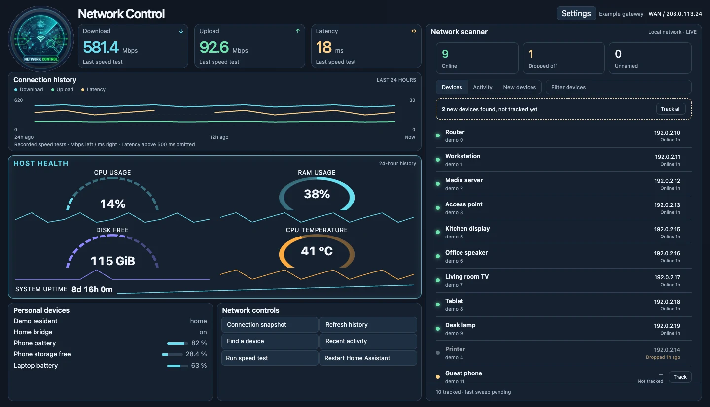
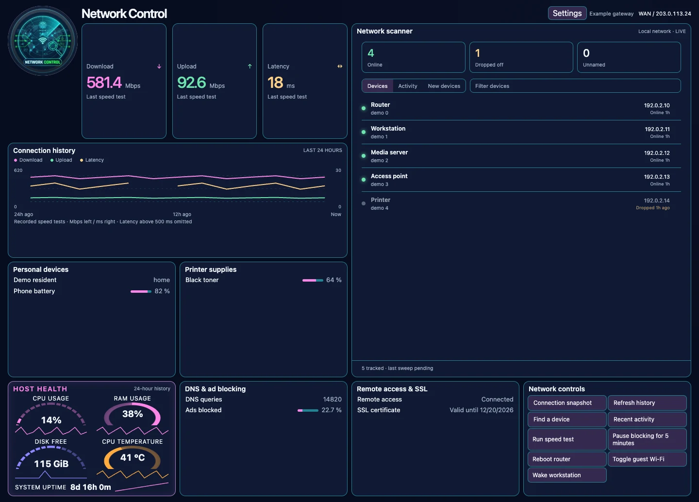
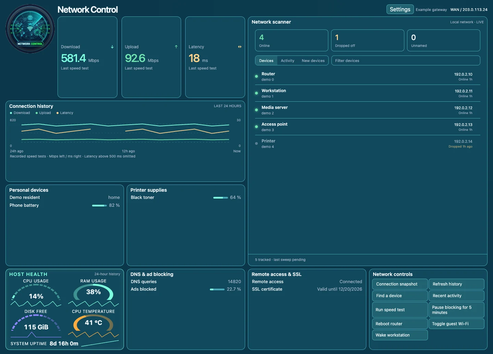
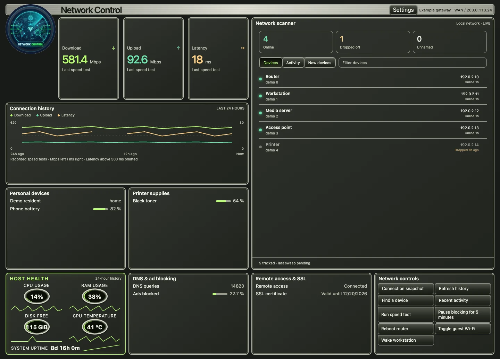
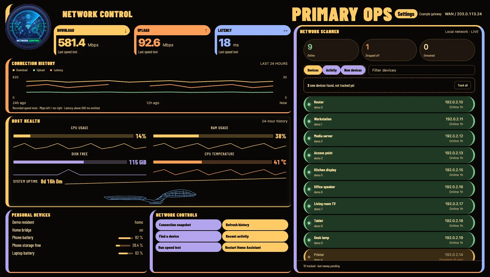

# Network Control theme gallery

Every screenshot uses the same fictional devices and sample readings. **Follow Appearance** shows an example shared palette.

[Return to setup instructions](../README.md)

## Network Control

## Brushed Steel

## Amber Relay

## Neon Grid

## Midnight Drift

## Aqua Current

## Mac Control

## Star Trek

## Follow Appearance

