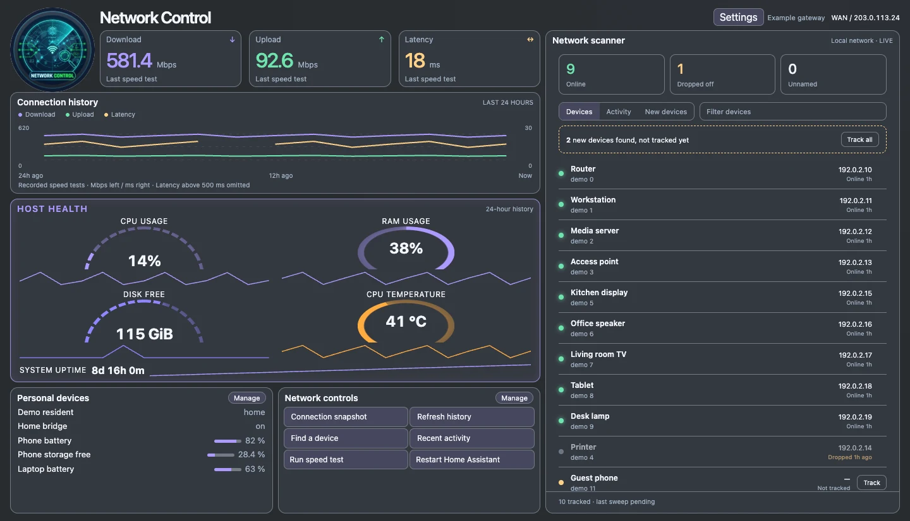
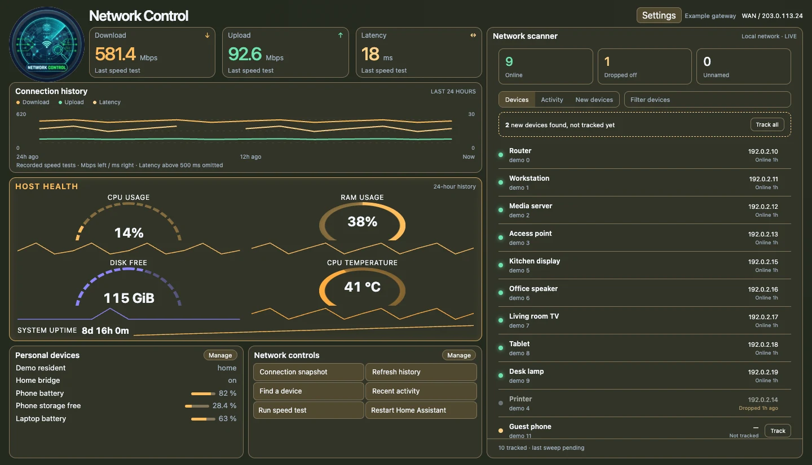
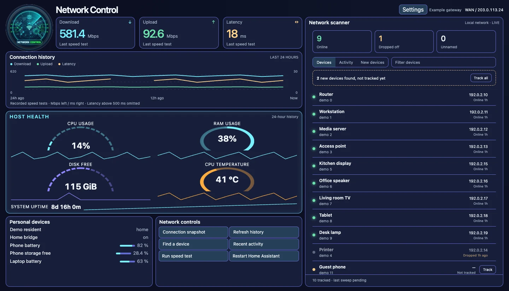
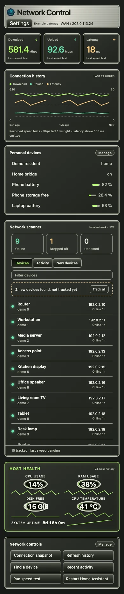
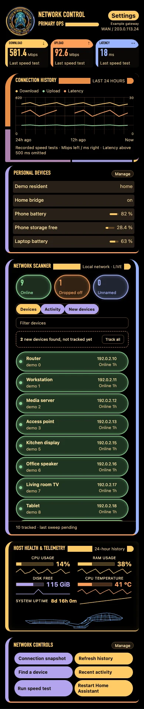
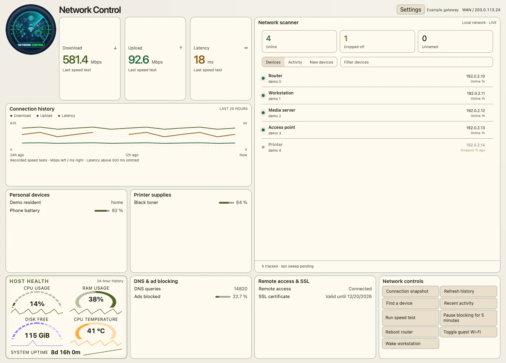
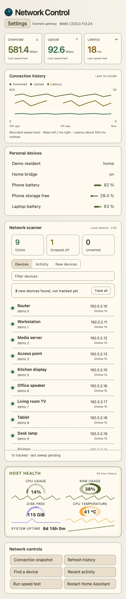

# Network Control theme gallery

Desktop and mobile screenshots use the same fictional devices and sample readings. The mobile screenshots are 390 pixels wide and show the full scrollable dashboard. Select an image to open it at full size. **Follow Appearance** shows an example shared palette.

[Return to setup instructions](../README.md)

## Network Control

<table>
<tr><th>Desktop</th><th>Mobile</th></tr>
<tr>
<td valign="top"></td>
<td valign="top"></td>
</tr>
</table>

## Brushed Steel

<table>
<tr><th>Desktop</th><th>Mobile</th></tr>
<tr>
<td valign="top"></td>
<td valign="top"></td>
</tr>
</table>

## Amber Relay

<table>
<tr><th>Desktop</th><th>Mobile</th></tr>
<tr>
<td valign="top"></td>
<td valign="top"></td>
</tr>
</table>

## Neon Grid

<table>
<tr><th>Desktop</th><th>Mobile</th></tr>
<tr>
<td valign="top"></td>
<td valign="top"></td>
</tr>
</table>

## Midnight Drift

<table>
<tr><th>Desktop</th><th>Mobile</th></tr>
<tr>
<td valign="top"></td>
<td valign="top"></td>
</tr>
</table>

## Aqua Current

<table>
<tr><th>Desktop</th><th>Mobile</th></tr>
<tr>
<td valign="top"></td>
<td valign="top"></td>
</tr>
</table>

## Mac Control

<table>
<tr><th>Desktop</th><th>Mobile</th></tr>
<tr>
<td valign="top"></td>
<td valign="top"></td>
</tr>
</table>

## Star Trek

<table>
<tr><th>Desktop</th><th>Mobile</th></tr>
<tr>
<td valign="top"></td>
<td valign="top"></td>
</tr>
</table>

## Follow Appearance

<table>
<tr><th>Desktop</th><th>Mobile</th></tr>
<tr>
<td valign="top"></td>
<td valign="top"></td>
</tr>
</table>
